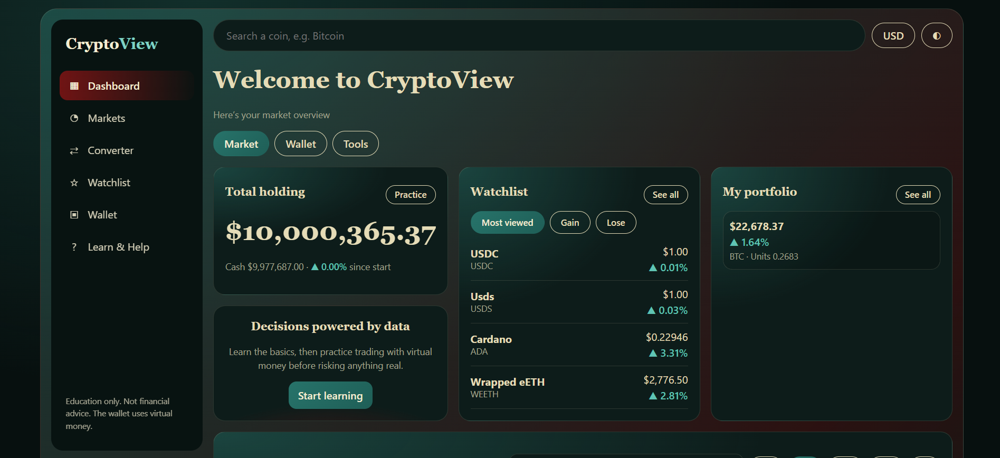
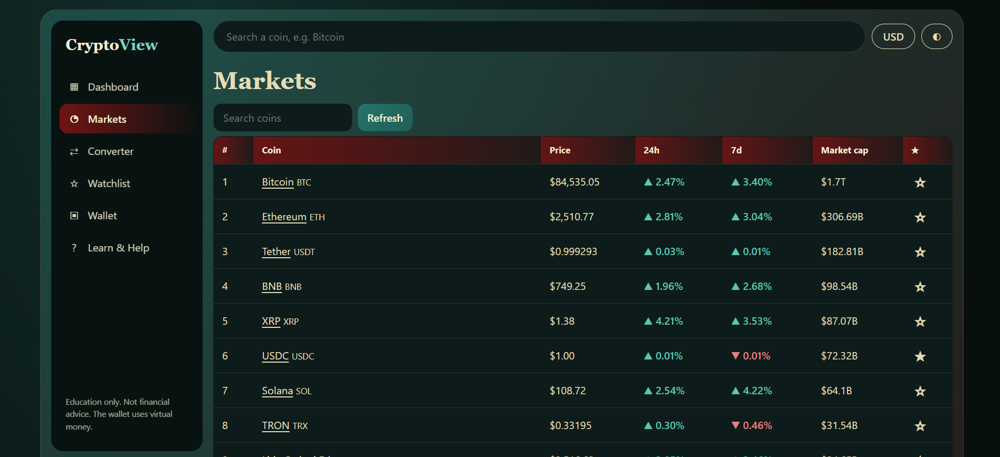
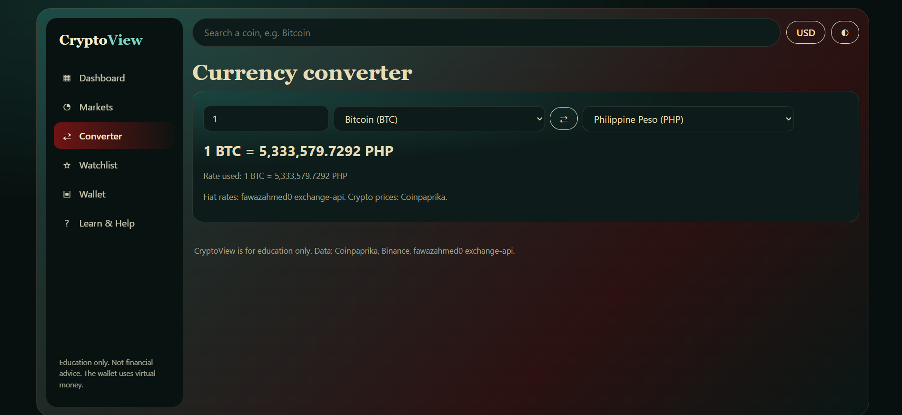
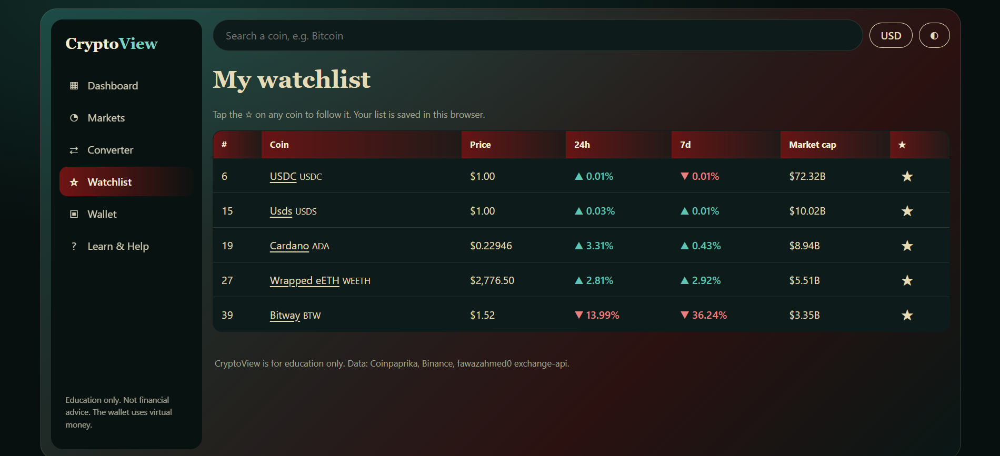
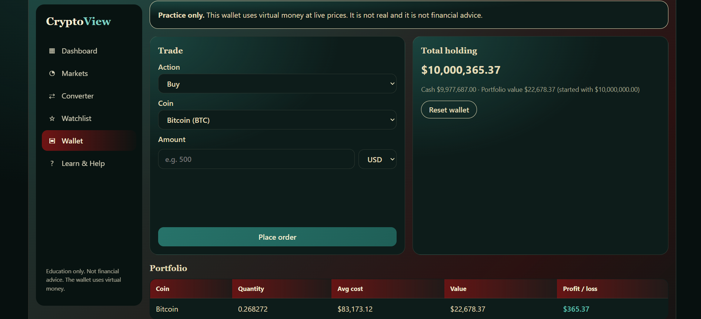
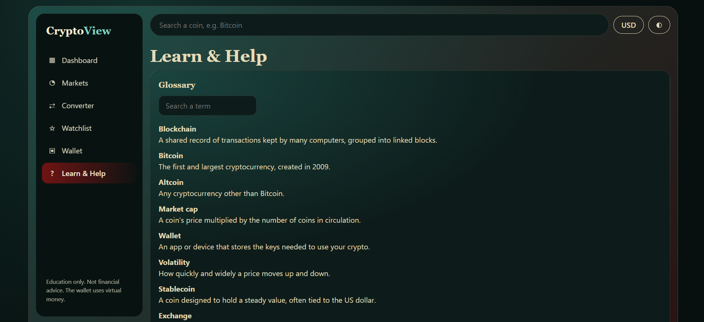
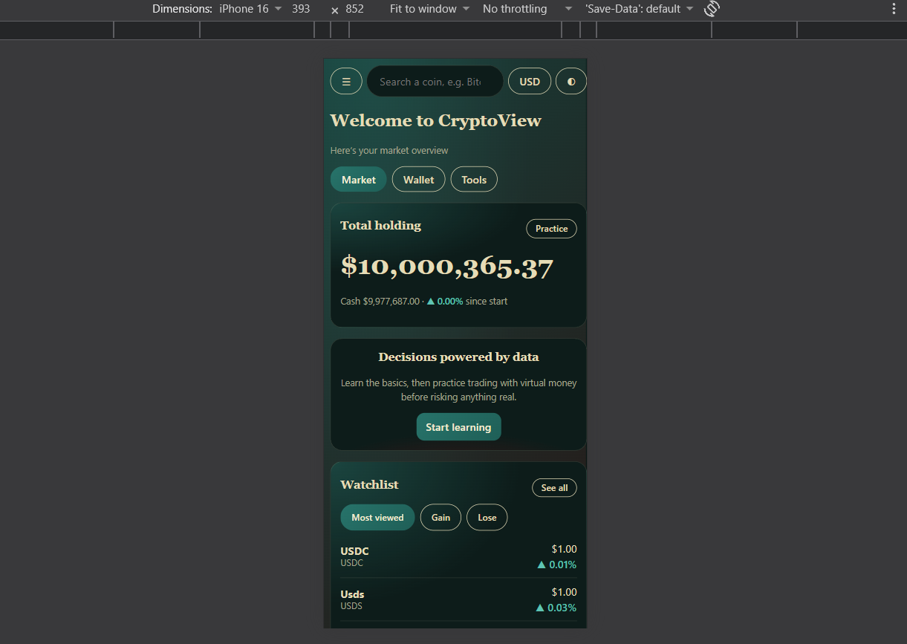

# CryptoView

## 1. Project Title

**CryptoView**

## 2. Project Description

CryptoView is a multi-page website that tracks the top 50 cryptocurrencies. It shows live prices, price charts, and market data, and it has a learning section and a practice wallet where you trade with virtual money.

It is built with plain HTML, CSS, and JavaScript (no frameworks) and gets its data from free public APIs that don't need an API key.

> **Education only.** CryptoView is not financial advice, and the practice wallet does not use real money.

## 3. Project Objectives

- Help beginners follow the crypto market in one simple place.
- Teach the basics with a glossary and an FAQ.
- Let users practice buying and selling with virtual money, so they can learn without risking anything real.
- Show how a multi-page website can share one layout, one stylesheet, and one JavaScript file.

## 4. Target Users

- Beginners who are curious about crypto but find it confusing.
- Students who want to learn how the market and trading work.
- Anyone who wants to practice trading without using real money.

## 5. Major Features

- **Dashboard:** total holding, watchlist (most viewed / gain / lose), portfolio summary, and a performance chart with a coin picker (1W to 1Y).
- **Markets:** top 50 coins with search, sortable columns (rank, price, 24h, 7d, market cap), a Refresh button, and a star to add coins to the watchlist.
- **Coin Detail:** price, rank, market cap, a 7/30/90-day chart with hover prices, a description, and shortcuts to Convert, Buy, and Sell.
- **Converter:** crypto to fiat, fiat to crypto, and crypto to crypto, with a swap button.
- **Watchlist:** all your starred coins in one place.
- **Practice Wallet:** buy and sell with virtual money in USD or PHP, with portfolio profit/loss and a filterable history.
- **Learn & Help:** searchable glossary, FAQ, and a feedback form with validation.
- **Extras:** light/dark theme, USD/PHP toggle, responsive layout (desktop, tablet, mobile), and saved data shown with a notice if an API fails.

## 6. Technologies Used

- HTML5
- CSS3 (custom properties for themes, grid and flexbox, media queries)
- Vanilla JavaScript (ES6+)
- HTML `<canvas>` for the charts (no chart library)
- Browser `localStorage` for the wallet, watchlist, theme, and currency
- Git and GitHub for version control

**APIs (all free, no key needed):**

| API | Used for |
|---|---|
| [Coinpaprika](https://api.coinpaprika.com) | Coin prices, changes, market cap, descriptions |
| [Binance public market data](https://data-api.binance.vision) | Daily candles for the charts |
| [fawazahmed0 exchange-api](https://github.com/fawazahmed0/exchange-api) | Currency exchange rates |
| [Frankfurter](https://api.frankfurter.dev) | Backup source for the PHP rate |

## 7. Team Members and Responsibilities

| Member | Responsibilities |
|---|---|
| **Enrique Miguel Derain** (group leader) | Shared layout, navigation, footer, global CSS, shared data module, Dashboard, Markets, Learn & Help, theme switcher, final integration testing |
| **Aeric Joseph Angeles** | Coin Detail page, price chart, Converter, currency toggle |
| **Dairnel Reese Sadsad** | Watchlist, Practice Wallet |

## 8. Running the Website Locally

You don't need to install anything or run a build step.

**Option A: open the file**
1. Clone or download the project.
2. Open `index.html` in your browser.

**Option B: use a local server (recommended)**
1. Clone the project:
   ```bash
   git clone https://github.com/EnriqueMiguel-Derain/CryptoView-website.git
   cd CryptoView-website
   ```
2. Start a simple server, using either one:
   ```bash
   # Python
   python3 -m http.server 8000

   # or Node.js
   npx serve .
   ```
3. Open `http://localhost:8000` in your browser.

**Notes:**
- You need an internet connection, since the prices come from live APIs.
- The wallet and watchlist are saved in your browser, so clearing your browser data resets them.

**Project structure:**
```
CryptoView-website/
├── index.html       # Dashboard
├── markets.html     # Top 50 coins
├── coin.html        # Coin detail and chart
├── converter.html   # Currency converter
├── watchlist.html   # Starred coins
├── wallet.html      # Practice wallet
├── learn.html       # Glossary, FAQ, feedback form
├── css/
│   └── style.css    # Shared styles, themes, responsive layout
└── js/
    └── app.js       # Shared code: nav, theme, currency, API calls, charts
```

## 9. GitHub Repository

https://github.com/EnriqueMiguel-Derain/CryptoView-website

## 10. Screenshots

| Page | Screenshot |
|---|---|
| Dashboard |  |
| Markets |  |
| Converter |  |
| Watchlist |  |
| Practice Wallet |  |
| Learn & Help |  |
| Mobile view |  |
